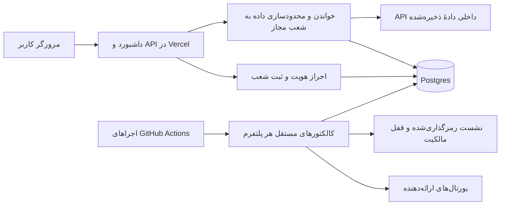

# ممیزی معماری و امنیت — ۱۹ اکتبر ۲۰۲۶

## نتیجهٔ اجرایی

معماری موجود برای یک داشبورد داخلی چندپلتفرمی پایهٔ مناسبی دارد: مرورگر به نشست کالکتورها دسترسی ندارد؛ کار سنگین جمع‌آوری خارج از درخواست وب اجرا می‌شود؛ دادهٔ ذخیره‌شده از طریق کنترل دسترسی شعب ارائه می‌شود. بازنویسی کلی یا افزودن سرویس‌های متعدد در این مرحله توجیهی ندارد. با این حال، «همه‌چیز در بهترین حالت» یا آمادگی برای بار بالا اثبات نشده است.

دامنه: بررسی عمیق کد داشبورد، احراز هویت و مسیرهای API؛ بررسی مرزهای نشست/اجرای کالکتورهای طلبات، کیتا، نون و دلیورو؛ ممیزی وابستگی‌های اجرایی هر پنج مخزن؛ تنظیمات حفاظتی مخزن داشبورد. این بررسی تست نفوذ کامل، آزمون بار، اسکن تمام تاریخچهٔ Git یا اثبات بازیابی بکاپ نیست. هیچ رمز، کاربر، دسترسی یا دادهٔ واقعی برای آزمایش تغییر نکرد.

## ساختار فعلی

نقاط قوت مشاهده‌شده:
- API ابری پیش از داده‌های داشبورد requireUser را اجرا می‌کند؛ خواندن تاریخچه نیز به شعب مجاز محدود می‌شود. سرور Express محلی مسیر جداگانه و bind محدود به loopback دارد؛ نبود احراز هویت آن به معنی باز بودن API ابری نیست.
- رمزها با scrypt و salt تصادفی ذخیره می‌شوند؛ توکن نشست تصادفی است و فقط هش آن در دیتابیس قرار می‌گیرد. کوکی Secure/HttpOnly/SameSite=Strict و انقضای ۱۲ ساعته دارد؛ تغییر سطح دسترسی session_version را عوض می‌کند.
- CSP، no-store برای دادهٔ خصوصی، nosniff، کنترل Origin برای تغییرات و پرس‌وجوی پارامتری وجود دارند.
- ثبت شعب از منبع/شناسهٔ پلتفرم مستقل از نام نمایشی است؛ داده‌ها قبل از پاسخ محدود به شعب مجاز می‌شوند.
- خواندن ترکیبی ریویوها transaction از نوع repeatable-read/read-only و statement_timeout دارد؛ خطای رابطهٔ سفارش به موفقیت خالی تبدیل نمی‌شود.
- خواندن ratings مستقل و deadlineدار است؛ خرابی یک پلتفرم می‌تواند به نتیجهٔ جزئیِ صریح تبدیل شود. این به معنی لغو قطعی همهٔ SQLهای در حال اجرا نیست.
- کالکتورها دارای محدودیت دامنه، اعتبارسنجی پاسخ، ذخیرهٔ نشست و مکانیزم‌های مالکیت/قفل هستند. سیاست‌های مبهمِ ایجاد گزارش به retry نامحدود تبدیل نشده‌اند.
- secret scanning و push protection در مخزن داشبورد فعال‌اند؛ این ویژگی‌ها اثبات نبود تمام اسرار تاریخی نیستند.

## اصلاحات این ممیزی

| اولویت | یافته و اثر | اصلاح و شاهد |
|---|---|---|
| P1 | resetPassword برخلاف updateUser کنترل مالک را نداشت؛ مدیر عادی می‌توانست رمز مالک را بازنشانی کند | password-reset.ts نقش و وضعیت فعلی عامل را از DB بازخوانی می‌کند، مالک را محافظت می‌کند و تغییر رمز، ابطال نشست و audit را در یک transaction انجام می‌دهد. آزمون SQL واقعی با PGlite: مدیر عادی/حساب غیرفعال رد می‌شوند؛ شکست audit تمام تغییرات را rollback می‌کند. |
| P2 | شمارندهٔ ورود ناموفق با read-modify-write خارج از transaction در درخواست‌های هم‌زمان قابل از دست رفتن بود؛ تلاش روی حساب قفل‌شده زمان قفل را تمدید می‌کرد | login-attempts.ts یک UPDATE اتمیک دارد؛ پنج شکست هم‌زمان قفل می‌کنند، تلاش در دورهٔ قفل آن را تمدید نمی‌کند و بعد از انقضا شمارش تازه آغاز می‌شود. |
| P2 | شکست schema initialization در Promise مشترک برای کل عمر نمونهٔ گرم باقی می‌ماند | auth-resilience.ts هم‌زمانی را حفظ می‌کند و پس از شکست، درخواست بعدی می‌تواند initialization را دوباره انجام دهد؛ retry نامحدود داخل همان درخواست ندارد. |
| P2 | کوکی خراب می‌توانست decodeURIComponent را به خطای 503 تبدیل کند | کوکی ناشناخته/خراب اکنون بدون exception، بدون احراز هویت تلقی می‌شود؛ قالب توکن موجود حفظ شده است. |
| P2 مشروط | lockfile داشبورد proxy-addr 2.0.7 داشت و ممیزی رجیستری یک هشدار Critical گزارش کرد | فقط این وابستگی به 2.0.8 ارتقا یافت؛ audit اجرایی بعدی صفر هشدار دارد. شرایط exploit به پیکربندی trust subnet مربوط است؛ در کد محلی trust proxy فعال نیست و API ابری Express را import نمی‌کند، بنابراین Critical رجیستری را با آسیب‌پذیری اثبات‌شدهٔ سایت زنده یکی نمی‌دانیم. |
| P2 | داشبورد workflow آزمون قبل/بعد از push نداشت | verify.yml ساخت TypeScript، همهٔ تست‌ها و audit اجرایی را روی push و PR با مجوز read-only اجرا می‌کند. این به تنهایی main را محافظت یا deployment را مشروط نمی‌کند. |
| P2 | gitignore فقط .env را پوشش می‌داد؛ فایل‌های .env.local و خروجی‌های خصوصی می‌توانستند اشتباهاً stage شوند | الگوهای .env.*، .secrets، .vercel و outputs اضافه شدند؛ فایل‌های موجود پاک یا منتشر نشدند؛ outputs از بستهٔ Vercel نیز کنار گذاشته شد. |

منبع هشدار وابستگی و شرایط آن: [GHSA-jqcg-44mw-7w3h](https://github.com/advisories/GHSA-jqcg-44mw-7w3h).

## موارد باز با اولویت اجرایی

| اولویت | شواهد و محدودیت | اقدام مشخص بعدی / معیار اتمام |
|---|---|---|
| P1 عملیاتی | مدرکی از restore آزمایشی پایگاه‌داده و تنظیمات فعلی بکاپ/نگهداری در دامنهٔ این بررسی نداریم؛ نبود مدرک به معنی نبود بکاپ نیست | وضعیت بکاپ و PITR ارائه‌دهنده را بخوانیم؛ restore به محیط مجزا بدون اتصال به production، سپس تطبیق شمارش/کلیدها و ثبت زمان بازیابی. قبل از این، تضمین بازیابی داده نمی‌دهیم. |
| P2 امنیت | auth.ts برای اتصال غیرمحلی rejectUnauthorized:false دارد؛ رمزگذاری TLS به معنی اعتبارسنجی هویت سرور نیست. بعضی گزینه‌های DSN نیز می‌توانند تنظیم ssl را بازنویسی کنند | قبل از تغییر زنده، قرارداد TLS و CA واقعی ارائه‌دهنده و رفتار pg/DSN آزمایش شود؛ سپس اتصال با اعتبارسنجی گواهی فعال گردد. تغییر کورکورانه می‌تواند ورود و همهٔ خواندن‌ها را قطع کند. |
| P2 امنیت | قفل سطح حساب وجود دارد؛ کنترل پایدار و سراسری نرخ درخواست‌های ورود یا محدودیت سطح IP در کد دیده نشد. قوانین edge فعلی در این ممیزی خوانده نشده‌اند | سیاست محافظت edge را بررسی و در صورت نبود، محدودیت متناسب با کاربران واقعی + پیام 429 + تست نمونه‌های توزیع‌شده اضافه شود؛ حافظهٔ یک تابع serverless کافی نیست. سیاست حداقل رمز فعلی ۶ نویسه است و تغییر آن نیاز به تصمیم سازگاری حساب‌ها دارد. |
| P2 تحویل | main از API گیت‌هاب بدون branch protection گزارش شد؛ Dependabot security updates غیرفعال بود | بعد از موفقیت CI، الزام check و بازبینی روی main تنظیم شود؛ محدودیت‌های حساب/طرح و مسیر انتشار موجود پیش از فعال‌سازی بررسی شوند. افزوده‌شدن workflow به‌تنهایی این مورد را حل نمی‌کند. |
| P2 پایداری/مقیاس | schema DDL در اولین درخواست هر نمونه اجرا می‌شود؛ Pool(max:3) سقف هر نمونه است و سقف کل نمونه‌های Vercel نیست. همهٔ queryها statement_timeout یکسان ندارند | مهاجرت نسخه‌دار خارج از مسیر درخواست، کاربر DB با حداقل مجوز و pooler ارائه‌دهنده، سپس اندازه‌گیری اتصال و زمان p95. مهار timeout باید سمت سرور DB هم باشد، نه فقط Promise.race. |
| P2 دامنهٔ شعب | ثبت شعب مرکزی وجود دارد ولی پین دامنه و استثنای دو شعبهٔ جدید طلبات هنوز در فایل/تنظیمات جداست | manifest نسخه‌دار از دامنهٔ صریحاً تأییدشده ساخته شود؛ افزودن/حذف با diff و تأیید هویت حساب، نه قبول خودکار هر تعداد. شعبهٔ بدون داده باید حالت pending داشته باشد و تاریخچهٔ مصنوعی نگیرد. |
| P2 هماهنگی کار | GitHub concurrency با cancel-in-progress:false صف نامحدود نمی‌سازد؛ در تست واقعی این جلسه یک اجرای pending با dispatch بعدی جایگزین شد | صف درخواست‌های DB و تأیید run_id مبنا باشند؛ آزمون سه درخواست هم‌زمان/runner busy/dispatch مبهم. کلید مشترک نشست حفظ شود و برای افزایش throughput قفل دور زده نشود. |
| P2 داده/حریم خصوصی | برخی خواندن‌های report ابتدا response.text و سپس محدودیت بایت دارند؛ دادهٔ سفارش/مشتری باید حداقل لازم بماند. نگهداری و نقش‌های DB واقعی ممیزی نشدند | خواندن bounded stream در همهٔ proxyها یکسان شود؛ سیاست نگهداری و فهرست فیلدهای ضروری، سپس دسترسی DB و خروجی‌های export بررسی شوند. |
| P3 نگهداشت | cloud-api.ts چند dataset و عملیات را در شرط‌های فشرده دارد؛ auth.ts چند مسئولیت و public/*.js منطق نمایش/تحلیل متراکم دارند | استخراج تدریجی handler هر dataset، policy مستقل دسترسی و ماژول‌های کوچک‌تر با حفظ contract tests. بازنویسی یک‌باره یا انتقال به microservices پیشنهاد نمی‌شود. |
| P3 عملکرد | no-store سراسری دارایی‌ها را نیز دوباره می‌گیرد؛ پوشش آزمون بار و ظرفیت عددی نداریم | فایل‌های asset با نام هش‌شده و immutable cache از API خصوصی جدا شوند؛ سناریوی ۱۰/۵۰ کاربر هم‌زمان در محیط آزمایشی با شمار اتصال، p95 و خطای وابستگی اندازه‌گیری شود. ظرفیت فعلی از اندازهٔ فایل یا پاس شدن unit test قابل استنتاج نیست. |

## اعتبارسنجی و حدود ادعا

- ساخت TypeScript برای src و APIهای Vercel موفق شد.
- تمام ۲۳۲ تست داشبورد، شامل شش تست جدید احراز هویت/پایداری، پاس شدند. شواهد محلی: outputs/architecture-audit-tests-2026-10-19.txt.
- audit --omit=dev در طلبات، کیتا، نون و دلیورو صفر هشدار شناخته‌شده گزارش کرد؛ داشبورد بعد از اصلاح نیز صفر بود. این بررسی فقط advisoryهای رجیستری در همین زمان و وابستگی‌های اجرایی است، نه اثبات امنیت تمام کد یا مرورگر Chromium.
- هیچ آزمون مخرب، reset واقعی حساب، تغییر secrets یا بازنویسی دادهٔ واقعی انجام نشد. تغییرات این ممیزی به داشبورد و فرایند آزمون آن محدود است؛ کالکتورها در این ممیزی تغییر نکردند.
- انتشار و نتیجهٔ CI زنده در پایان کار جداگانه ثبت می‌شود؛ پاس شدن تست محلی معادل انتشار نیست.
